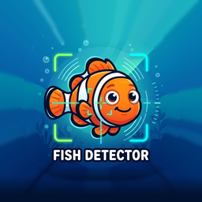
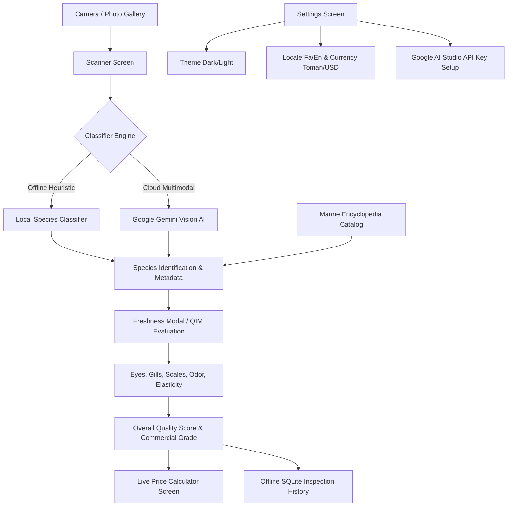
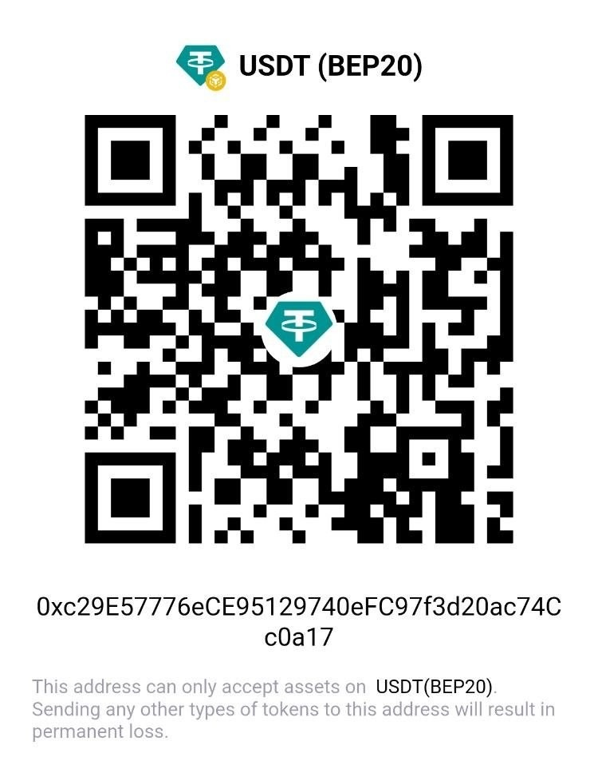

# Market Fish Inspector (سامانه تشخیص هوشمند ماهی و سنجش کیفیت بازار)

<p align="center">
  
</p>

<p align="center">
  <strong>An Intelligent Mobile Application for Real-Time Fish Species Recognition, Freshness Quality Inspection, and Market Valuation.</strong><br/>
  <em>نرم‌افزار جامع و هوشمند شناسایی گونه‌های ماهی، ارزیابی چندمعیاره تازگی و سلامت، و محاسبه ارزش روز بازار برای بازار ماهی، مصرف‌کنندگان و متخصصان شیلات.</em>
</p>

<p align="center">
  <a href="https://github.com/ehsaanpour/Fish-Detector/releases/latest"></a>
  <a href="https://expo.dev"></a>
  <a href="https://reactnative.dev"></a>
  <a href="https://github.com/ehsaanpour/Fish-Detector/actions/workflows/build-and-release-apks.yml"></a>
  <a href="#license--حمایت"></a>
</p>

---

## 📑 Table of Contents / فهرست مطالب
- [English Documentation](#-english-documentation)
  - [Overview](#overview)
  - [Key Features](#key-features)
  - [Application Architecture](#application-architecture)
  - [Directory Structure](#directory-structure)
  - [Getting Started & Local Setup](#getting-started--local-setup)
  - [Building APKs & CI/CD](#building-apks--cicd)
  - [Cafe Bazaar & Iranian App Stores](#cafe-bazaar--iranian-app-stores)
  - [Google Gemini AI Integration](#google-gemini-ai-integration)
- [راهنمای جامع فارسی (Persian Documentation)](#-راهنمای-جامع-فارسی-persian-documentation)
  - [معرفی سامانه](#معرفی-سامانه)
  - [قابلیت‌های کلیدی](#قابلیت‌های-کلیدی)
  - [دانشنامه گونه‌های ماهیان جنوب و شمال](#دانشنامه-گونه‌های-ماهیان-جنوب-و-شمال)
  - [ارزیابی چندمعیاره تازگی (روش QIM)](#ارزیابی-چندمعیاره-تازگی-روش-qim)
  - [دانلود نسخه‌های APK اندروید](#دانلود-نسخه‌های-apk-اندروید)
  - [راهنمای راه‌اندازی و توسعه](#راهنمای-راه‌اندازی-و-توسعه)
  - [توسعه‌دهنده و حمایت مالی](#توسعه‌دهنده-و-حمایت-مالی)

---

# 🇬🇧 English Documentation

## Overview
**Market Fish Inspector** is a high-performance cross-platform mobile application engineered with React Native and Expo. It empowers consumers, fishmongers, restaurateurs, and marine inspectors to instantly:
1. **Identify Commercial Fish Species** using on-device computer vision heuristics paired with optional cloud-accelerated multimodal Google Gemini Vision AI.
2. **Scientifically Evaluate Freshness** through standardized QIM (Quality Index Method) multi-sensory attributes (cornea transparency, gill coloration, scale adherence, muscular elasticity, and belly odor).
3. **Calculate Fair Market Value** with real-time currency conversion between Iranian Toman (TMN) and US Dollars ($ USD) based on weight and freshness grade.
4. **Browse an Offline Marine Atlas** containing high-definition specimen photographs, nutritional profiles, habitat details, and recommended culinary preparations.

---

## Key Features

### 🔍 1. Dual-Engine Fish Species Classifier
- **On-Device Offline Engine**: Colorimetric, aspect-ratio, and silhouette analysis running 100% offline with zero latency.
- **Multimodal Gemini Vision AI**: Seamless connection to Google AI Studio (Gemini 1.5 / 2.0 Flash) providing instant deep species classification, distinguishing challenging specimens (e.g., Narrow-barred Spanish Mackerel vs. King Mackerel, Black Pomfret vs. Silver Pomfret).

### 🔬 2. Multi-Factor Freshness & Quality Inspection (QIM)
Calculates a scientific freshness score (0% to 100%) and assigns commercial grades:
- **Grade 1 (ممتاز / Grade A)**: Pristine catch, crystal-clear convex eyes, vibrant crimson gills, firm elastic flesh.
- **Grade 2 (مصرف خانگی / Grade B)**: Standard freshness suitable for immediate cooking and freezing.
- **Grade 3 / Spoiled (غیرقابل مصرف / Unfit)**: Sunken cloudy eyes, brownish/mucus gills, foul odor, loss of muscle resilience.

### 💰 3. Live Price Calculator & Multi-Currency Engine
- Instant recalculation of market prices based on net weight (kg) and freshness quality factor.
- Seamless toggle between **Iranian Toman (تومان)** and **US Dollars ($ USD)** with localized number formatting.

### 📚 4. Comprehensive Marine Encyclopedia
- Pre-loaded offline catalog covering top Persian Gulf, Sea of Oman, and Caspian Sea commercial species (Kingfish/شیر, Silver Pomfret/حلوا سفید, Javelin Grunter/سنگسر, Mangrove Red Snapper/سرخو, Fourfinger Threadfin/راشگو, Tigertooth Croaker/شوریده, Tuna/هوور, Cobia/سکن, Sobaity Seabream/صبیتی, Rainbow Trout/قزل‌آلا, Common Carp/کپور, and more).
- Specimen photos stored locally—no missing images, even in remote fish docks without cellular signal.

### 🗄️ 5. 100% Offline SQLite History
- Saves all inspection logs, dates, notes, and photos locally using native SQLite storage.
- Never loses user inspection history when offline.

### 🎨 6. Modern RTL Persian & English Experience
- True **Right-to-Left (RTL)** layout for Persian alongside standard **Left-to-Right (LTR)** for English.
- Integrated **Vazirmatn (وزیرمتن)** font family bundled directly in native APK builds for crisp Persian typography.
- Night Market Dark Mode & Sunlight Daytime Light Mode with curated oceanic hues.

---

## Application Architecture



---

## Directory Structure

```text
Fish-Detector/
├── .github/
│   └── workflows/
│       └── build-and-release-apks.yml   # Automated Android APK compilation & release
├── assets/
│   ├── fish/                           # Offline high-definition fish specimen imagery
│   ├── fonts/                          # Vazirmatn Persian typography fonts
│   ├── app_logo.png                    # In-app brand badge (256x256)
│   ├── bazaar-icon-512.png             # Official Cafe Bazaar 512x512 store icon
│   ├── icon.png                        # Primary master app icon (1024x1024)
│   ├── android-icon-foreground.png     # Android adaptive icon foreground
│   ├── android-icon-background.png     # Android adaptive icon background
│   └── donation_qr.jpg                 # Creator donation QR code
├── plugins/
│   └── withAndroidSplits.js            # Expo Config Plugin for APK architecture splitting
├── src/
│   ├── components/                     # Reusable UI components (HeaderBar, FreshnessModal, etc.)
│   ├── database/                       # Native SQLite storage & inspection history
│   ├── engine/
│   │   ├── ai/                         # Google Gemini Vision multimodal service
│   │   └── cv/                         # Species classification & freshness algorithms
│   ├── localization/                   # English & Persian translations & currency formats
│   ├── navigation/                     # Tab bar & screen navigators
│   ├── screens/                        # HomeScreen, ScannerScreen, PriceCalculator, Settings, Detail
│   └── theme/                          # Oceanic dark and light color tokens
├── app.json                            # Expo application configuration & native permissions
└── package.json                        # Project dependencies and npm scripts
```

---

## Getting Started & Local Setup

### Prerequisites
- **Node.js**: `v20.x` or later
- **npm** or **bun**
- **Android Studio** (for local Android emulation / native building)

### 1. Clone the Repository
```bash
git clone https://github.com/ehsaanpour/Fish-Detector.git
cd Fish-Detector
```

### 2. Install Dependencies
```bash
npm install
```

### 3. Start Expo Development Server
```bash
npx expo start
```
- Press `a` to launch on a connected Android device or emulator.
- Press `w` to open in your web browser.

### 4. Code Quality & Type Checking
```bash
npx tsc --noEmit     # TypeScript type verification
npx expo lint        # ESLint rule verification
```

---

## Building APKs & CI/CD

The repository includes a GitHub Actions workflow (`.github/workflows/build-and-release-apks.yml`) configured to automatically compile and release all architecture variants on tag push:

- **Universal APK** (`Market-Fish-Inspector-vX.X.X-universal.apk`): Compatible with all devices.
- **arm64-v8a APK**: Optimized for modern 64-bit Android smartphones (smaller download size).
- **armeabi-v7a APK**: Optimized for legacy 32-bit Android phones.
- **x86_64 APK**: Optimized for Android emulators and ChromeOS tablets.
- **Debug APK**: For developers and testing.

To trigger a release manually, push an annotated tag:
```bash
git tag -a v1.0.2 -m "Market Fish Inspector v1.0.2"
git push origin v1.0.2
```

---

## Cafe Bazaar & Iranian App Stores
The application is pre-configured to comply with **Cafe Bazaar (کافه بازار)** and **Myket (مایکت)** store requirements:
- **Application Icon**: Full-bleed `512 × 512` PNG at `assets/bazaar-icon-512.png` without artificial borders or pre-rendered shadows.
- **Package Name**: `com.fishdetector.marketapp`
- **Native Permissions**: Camera and Gallery storage permissions are properly rationalized in `app.json`.
- **Target SDK**: Android 14+ (API Level 34/35).

---

## Google Gemini AI Integration
The app operates seamlessly **100% offline**. However, users can optionally connect to Google AI Studio for enhanced recognition:
1. Visit [Google AI Studio](https://aistudio.google.com/app/apikey).
2. Generate a free Gemini API Key.
3. Open **Settings (تنظیمات)** inside the app, paste the key, and press **Save (ذخیره)**.

---

# 🇮🇷 راهنمای جامع فارسی (Persian Documentation)

## معرفی سامانه
**سامانه تشخیص هوشمند ماهی و سنجش کیفیت بازار (Market Fish Inspector)** یک نرم‌افزار تخصصی، مدرن و کاربردی برای گوشی‌های اندروید و وب است که با هدف ارتقای سلامت غذایی، جلوگیری از تقلب‌های رایج بازار آبزیان و توانمندسازی خریداران و فعالان حوزه شیلات طراحی و پیاده‌سازی شده است.

این نرم‌افزار به صورت **کاملاً مستقل و آفلاین** کار می‌کند و نیازی به اینترنت دائمی در حین حضور در اسکله‌ها یا بازارهای ماهی ندارد.

---

## قابلیت‌های کلیدی

### ۱. تشخیص هوشمند و خودکار گونه‌های ماهی
- شناسایی گونه‌های تجاری خلیج فارس، دریای عمان و ماهیان شمال ایران از طریق دوربین زنده یا انتخاب تصویر از گالری.
- مجهز به دو موتور پردازش:
  - **موتور آفلاین اختصاصی**: پردازش بدون اینترنت با تحلیل مشخصات مورفولوژیک و الگوهای ظاهری.
  - **اتصال اختیاری به هوش مصنوعی Google Gemini Vision**: شناسایی فوق دقیق گونه‌های مشابه و دشوار (مانند تشخیص تفاوت ماهی شیر اصل از قباد، یا حلوا سفید و سیاه).

### ۲. ارزیابی چندمعیاره کیفیت و تازگی (روش استاندارد QIM)
سامانه با الهام از متد بین‌المللی **Quality Index Method (QIM)** وضعیت سلامت ماهی را با بررسی ۵ فاکتور ارزیابی می‌کند:
- **چشم‌ها (Eyes)**: بررسی تحدب قرنیه، شفافیت مردمک یا گودرفتگی و کدر بودن.
- **آبشش‌ها (Gills)**: رنگ قرمز آلبالویی درخشان و بوی جلبک دریایی تازه در برابر قهوه‌ای تیره و بوی آمونیاک.
- **پوست و فلس‌ها (Skin & Scales)**: درخشندگی، ترشح شفاف طبیعی و چسبندگی محکم فلس‌ها به پوست.
- **قوام و بافت گوشت (Firmness)**: سفتی ارتجاعی و بازگشت سریع بافت در اثر فشار انگشت.
- **بوی حفره شکمی (Odor)**: عاری بودن از بوی ترشیدگی، گندیدگی یا بادکردگی شکم.

بر اساس این معاینه، رتبه کیفی ماهی مشخص می‌شود:
- **درجه ۱ ممتاز**: ماهی تازه و صید روز، ایده‌آل برای مصرف خام/کبابی و نگهداری بلندمدت.
- **درجه ۲ معمولی**: کیفیت مناسب برای پخت و پز خانگی و انجماد در بازه کوتاه‌مدت.
- **غیرقابل مصرف (فاسد)**: شروع فرآیند تخریب بافت پروتئینی و خطر مسمومیت غذایی.

### ۳. ماشین حساب هوشمند ارزش روز بازار
- محاسبه سریع قیمت نهایی بار ماهی بر اساس **وزن خالص (کیلوگرم)**، **قیمت پایه بازار** و **ضریب درجه تازگی**.
- تبدیل لحظه‌ای و خودکار بین **تومان (TMN)** و **دلار آمریکا ($ USD)**.
- قابلیت ویرایش نرخ پایه برای انطباق با قیمت‌های محلی هر استان و بندر (بوشهر، بندرعباس، چابهار، خوزستان، شمال و...).

### ۴. اطلس و دانشنامه ماهیان تجاری
- معرفی کامل بیش از ده‌ها گونه شاخص تجاری با نام فارسی، نام محلی بنادر جنوب و شمال، نام انگلیسی و نام علمی رده‌بندی.
- حاوی تصاویر باکیفیت اطلس گونه‌ها ذخیره‌شده درون برنامه (بدون نیاز به دانلود یا لود اینترنتی).
- درج خواص غذایی، درصد امگا ۳، بافت گوشت (کم‌تیغ / پرتیغ) و بهترین شیوه‌های طبخ (قلیه‌ماهی، ته‌انداز، سرخ‌کردنی، کباب).

### ۵. پایگاه داده آفلاین تاریخچه بازرسی‌ها
- ذخیره خودکار گزارش‌های ارزیابی کیفی، تاریخ، نمره سلامت و تصویر در پایگاه‌داده محلی SQLite.
- امکان پاکسازی و مدیریت فضای ذخیره‌سازی از بخش تنظیمات.

### ۶. ظاهر حرفه‌ای، دوزبانه و تایپوگرافی وزیرمتن
- طراحی راست‌به‌چپ (RTL) استاندارد با پشتیبانی از فونت ملی **وزیرمتن (Vazirmatn)** در تمام اوزان در نسخه‌های نیتیو اندروید.
- حالت شب (Dark Mode مناسب بازارهای سرپوشیده و شبانه) و حالت روز (Light Mode).
- تعویض تک‌لمسی زبان بین فارسی و انگلیسی در هدر اصلی برنامه.

---

## دانشنامه گونه‌های ماهیان جنوب و شمال
برخی از گونه‌های تحت پوشش پایگاه‌داده برنامه:
- **ماهی شیر** (*Scomberomorus commerson* - Narrow-barred Spanish Mackerel)
- **حلوا سفید / زبیدی** (*Pampus argenteus* - Silver Pomfret)
- **حلوا سیاه** (*Parastromateus niger* - Black Pomfret)
- **سنگسر معمولی** (*Pomadasys argenteus* - Javelin Grunter)
- **سرخو** (*Lutjanus johnii* - John's Snapper / Mangrove Red Snapper)
- **راشگو** (*Eleutheronema tetradactylum* - Fourfinger Threadfin)
- **شوریده** (*Otolithes ruber* - Tigertooth Croaker)
- **هوور / ماهی تن** (*Thunnus albacares* - Yellowfin Tuna)
- **قباد** (*Scomberomorus guttatus* - Indo-Pacific King Mackerel)
- **کپور معمولی** (*Cyprinus carpio* - Common Carp)
- **قزل‌آلای رنگین‌کمان** (*Oncorhynchus mykiss* - Rainbow Trout)
- **صبیتی** (*Sparidentex hasta* - Sobaity Seabream)
- **سکن / سوکلا** (*Rachycentron canadum* - Cobia)
- **میش‌ماهی** (*Argyrosomus hololepidotus* - Southern Meagre / Spotted Croaker)
- **هامور معمولی** (*Epinephelus coioides* - Orange-spotted Grouper)
- **کفشک‌ماهی** (*Pseudorhombus elevatus* - Flatfish / Sole)
- و سایر گونه‌های شاخص آب‌های خلیج فارس، دریای عمان و منابع آب شیرین.

---

## دانلود نسخه‌های APK اندروید

تمامی نسخه‌های کامپایل‌شده برنامه به صورت مستقیم از بخش [Releases گیت‌هاب](https://github.com/ehsaanpour/Fish-Detector/releases/latest) قابل بارگیری هستند:

- 🌟 **نسخه جامع (Universal APK)**: سازگار با تمامی مدل‌ها و معماری‌های پردازنده اندروید (پیشنهادی برای نصب عمومی).
- ⚡ **نسخه ۶۴ بیتی (arm64-v8a)**: بهینه‌شده برای گوشی‌های مدرن اندروید با حجم دانلودی کمتر و عملکرد بالاتر.
- 📦 **نسخه ۳۲ بیتی (armeabi-v7a)**: مناسب گوشی‌ها و تبلت‌های قدیمی‌تر.
- 💻 **نسخه شبیه‌ساز (x86_64)**: مناسب اجرا روی نرم‌افزارهای شبیه‌ساز ویندوز یا تبلت‌های کروم‌بوک.
- 🏪 **آیکون رسمی کافه بازار (`bazaar-icon-512.png`)**: فایل ۵۱۲×۵۱۲ پیکسل استاندارد برای ناشران در پنل کافه بازار.

---

## راهنمای راه‌اندازی و توسعه

### پیش‌نیازها
- نصب نسخه ۲۰ یا جدیدتر از [Node.js](https://nodejs.org/)
- نرم‌افزار Git

### مراحل اجرا
```bash
# کلون کردن پروژه
git clone https://github.com/ehsaanpour/Fish-Detector.git
cd Fish-Detector

# نصب وابستگی‌ها
npm install

# اجرای سرور توسعه اکسپو
npx expo start
```
- برای مشاهده روی مرورگر کامپیوتر کلید `w` را بفشارید.
- برای مشاهده روی گوشی، برنامه **Expo Go** را نصب کرده و کد QR ایجادشده در ترمینال را اسکن کنید.

---

## توسعه‌دهنده و حمایت مالی

این نرم‌افزار به صورت **۱۰۰٪ رایگان و آزاد** توسط **احسان احسان‌پور (Ehsan Ehsanpour)** برای جامعه ایرانیان، علاقه‌مندان به شیلات و مصرف‌کنندگان توسعه یافته است.

اگر این نرم‌افزار برای شما مفید واقع شده است و مایل به حمایت از تداوم توسعه، افزودن گونه‌های جدید و سرورهای هوش مصنوعی هستید، می‌توانید از طریق آدرس تتر (USDT شبکه بایننس اسمارت چین BEP20) اقدام فرمایید:

```text
شبکه: USDT (BEP20)
آدرس کیف‌پول: 0xc29E57776eCE95129740eFC97f3d20ac74Cc0a17
```

<p align="center">
  <br/>
  <em>اسکن بارکد کیف‌پول اهدای تتر (BEP20)</em>
</p>

---

<p align="center">
  توسعه داده شده با ❤️ برای ارتقای سلامت سفره خانواده‌ها و صیادان زحمتکش ایران زمین.
</p>
